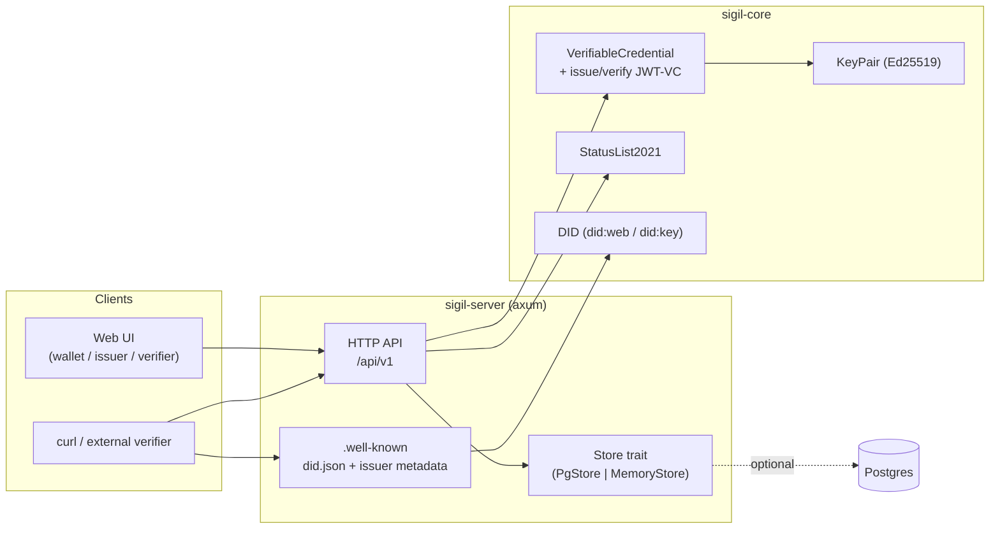
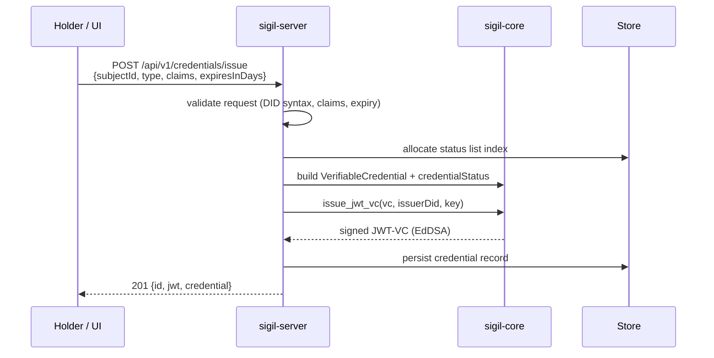
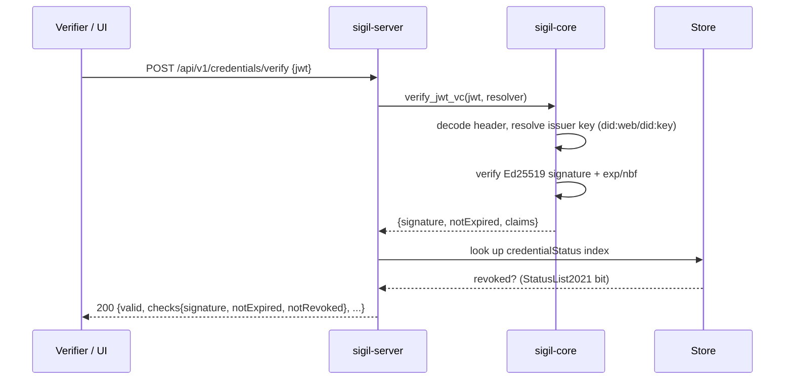

# Sigil

[](https://github.com/sigil-id/sigil/actions/workflows/ci.yml)
[](./LICENSE)

Sigil is a standards-based platform for issuing, holding, and verifying
[W3C Verifiable Credentials](https://www.w3.org/TR/vc-data-model/). It signs
credentials with Ed25519, encodes them as JWT-VCs (JOSE/EdDSA), publishes
revocation state through StatusList2021, and exposes an OID4VCI-style issuer
metadata endpoint. The backend is written in Rust; the reference wallet, issuer,
and verifier UI is React + TypeScript.

The project favours boring, interoperable primitives over bespoke cryptography:
every credential Sigil produces can be verified by any conforming JWT-VC verifier
that can resolve `did:web` and `did:key`.

## Features

- **Issue** JWT-VC credentials from a `did:web` issuer with Ed25519 (EdDSA) signatures.
- **Verify** credentials offline-friendly: signature, expiry, and revocation checks
  reported independently so callers can apply their own policy.
- **Revocation** via StatusList2021 — a gzip-compressed, base64url bitstring served
  as its own Verifiable Credential.
- **DID support** for `did:web` (issuers) and `did:key` (subjects/holders), including
  a served DID document at `/.well-known/did.json`.
- **OID4VCI issuer metadata** at `/.well-known/openid-credential-issuer`.
- **Runs without a database.** With no `DATABASE_URL` set, the server falls back to an
  in-memory store so the full issue/verify loop works out of the box.
- **Reference UI**: wallet (holder), issuer, and verifier flows, WCAG 2.1 AA oriented.

## Architecture



### Issuance



### Verification



## Standards

| Standard | Role in Sigil |
| --- | --- |
| [W3C Verifiable Credentials Data Model 1.1](https://www.w3.org/TR/vc-data-model/) | Credential JSON shape |
| [JWT-VC](https://www.w3.org/TR/vc-data-model/#json-web-token) | Credential encoding |
| [JOSE / EdDSA (RFC 8037)](https://www.rfc-editor.org/rfc/rfc8037) | Signature algorithm |
| [did:key](https://w3c-ccg.github.io/did-method-key/) | Subject / holder identifiers |
| [did:web](https://w3c-ccg.github.io/did-method-web/) | Issuer identifier |
| [StatusList2021](https://www.w3.org/community/reports/credentials/CG-FINAL-vc-status-list-2021-20230102/) | Revocation |
| [OpenID for Verifiable Credential Issuance](https://openid.net/specs/openid-4-verifiable-credential-issuance-1_0.html) | Issuer metadata |

## Quickstart

Bring up Postgres, the server, and the web UI:

```bash
docker compose up --build
```

The API listens on `http://localhost:8080` and the UI on `http://localhost:5173`.
The server also runs standalone without Postgres (in-memory store):

```bash
cargo run -p sigil-server
```

### Issue a credential

```bash
curl -s http://localhost:8080/api/v1/credentials/issue \
  -H 'content-type: application/json' \
  -d '{
    "subjectId": "did:key:z6MkhaXgBZDvotDkL5257faiztiGiC2QtKLGpbnnEGta2doK",
    "type": "EmploymentCredential",
    "claims": { "role": "Staff Engineer", "employer": "Acme Corp" },
    "expiresInDays": 365
  }'
```

Response (abridged):

```json
{
  "id": "urn:uuid:6f9d...",
  "jwt": "eyJhbGciOiJFZERTQSItyp...",
  "credential": {
    "@context": ["https://www.w3.org/2018/credentials/v1"],
    "type": ["VerifiableCredential", "EmploymentCredential"],
    "issuer": "did:web:localhost%3A8080",
    "credentialSubject": { "id": "did:key:z6Mkha...", "role": "Staff Engineer" }
  }
}
```

### Verify a credential

```bash
JWT="eyJhbGciOiJFZERTQSI..."   # the jwt from the issue response

curl -s http://localhost:8080/api/v1/credentials/verify \
  -H 'content-type: application/json' \
  -d "{\"jwt\": \"$JWT\"}"
```

```json
{
  "valid": true,
  "checks": { "signature": true, "notExpired": true, "notRevoked": true },
  "issuer": "did:web:localhost%3A8080",
  "subject": "did:key:z6Mkha...",
  "credential": { "...": "..." }
}
```

### Revoke, then re-verify

```bash
curl -s -X POST http://localhost:8080/api/v1/credentials/urn:uuid:6f9d.../revoke
# re-verifying the same JWT now returns checks.notRevoked = false and valid = false
```

## API overview

Base path: `/api/v1`.

| Method | Path | Description |
| --- | --- | --- |
| `GET` | `/health` | Liveness probe. |
| `GET` | `/.well-known/did.json` | Issuer `did:web` DID document. |
| `GET` | `/.well-known/openid-credential-issuer` | OID4VCI issuer metadata. |
| `POST` | `/api/v1/credentials/issue` | Issue a new JWT-VC. |
| `POST` | `/api/v1/credentials/verify` | Verify a JWT-VC (signature, expiry, revocation). |
| `GET` | `/api/v1/credentials` | List issued credentials (`limit`, `offset`). |
| `GET` | `/api/v1/credentials/:id` | Fetch a stored credential record. |
| `POST` | `/api/v1/credentials/:id/revoke` | Revoke a credential. |
| `GET` | `/api/v1/status/:listId` | StatusList2021 credential (JWT-VC). |

Full schemas: [`docs/openapi.yaml`](./docs/openapi.yaml).

## Repository layout

```
crates/
  sigil-core/     Core VC / DID / crypto library (no I/O).
  sigil-server/   axum HTTP service, storage, config.
migrations/       sqlx Postgres migrations.
web/              Vite + React + TypeScript reference UI.
infra/            Dockerfiles, docker-compose, terraform skeleton.
docs/             Design notes, OpenAPI spec.
```

## Development

Prerequisites: a stable Rust toolchain (see `rust-toolchain.toml`), Node.js 20+
with pnpm, and optionally Docker.

```bash
# Backend
cargo fmt
cargo clippy --all-targets -- -D warnings
cargo test
cargo run -p sigil-server

# Frontend
cd web
pnpm install
pnpm typecheck && pnpm lint && pnpm test
pnpm dev
```

Configuration is via environment variables; see `crates/sigil-server/.env.example`.
The most relevant are `DATABASE_URL` (optional), `SIGIL_ISSUER_HOST`,
`SIGIL_BIND`, and `SIGIL_ISSUER_KEY_PKCS8_B64`.

## Roadmap

- Selective disclosure via SD-JWT-VC.
- BBS+ / LD-proof credential format alongside JWT-VC.
- OID4VP presentation and verifier request flows.
- did:web key rotation and versioned DID documents.
- Pluggable KMS / HSM backing for issuer keys.

## License

Licensed under the [Apache License, Version 2.0](./LICENSE).
